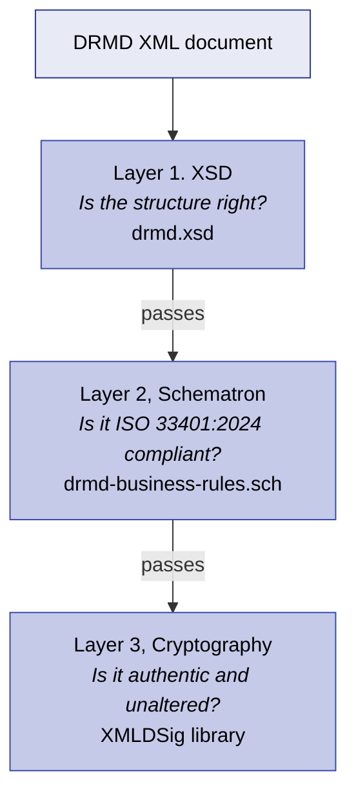

# Validation Rules & Severity

XSD validation tells you a document is structurally correct. It does not tell you the document is
compliant with ISO 33401:2024, and it certainly does not tell you the document is trustworthy.
Three separate layers are involved, and each answers a different question.



Layers 1 and 2 are both required for conformance. Layer 3 applies where signatures are used.

---

## 12.1 Layer 1 (XSD)

### What it does

A validator must validate the instance against `drmd.xsd` and resolve the imports for `dcc.xsd`,
`SI_Format.xsd`, `quantitykind.xsd` and `xmldsig-core-schema.xsd`. It enforces element names,
sequence order, cardinalities and data types.

!!! warning "Resolve imports from the local bundle, not the network"
    `drmd.xsd` does not compile at all if the QUDT quantity-kind type cannot be resolved: D-SI
    declares `si:quantityTypeQUDT` with that type, and an unresolvable type reference invalidates
    the entire schema. Use the schema repository's `catalog.xml`, which maps every remote address
    to the vendored copy:

    ```bash
    export XML_CATALOG_FILES=/path/to/schema/catalog.xml
    xmllint --noout --nonet --schema drmd.xsd my-document.xml
    ```

    Fetching schemas at validation time is worse than inconvenient: an upstream revision can
    change what counts as valid between two runs of the same check.

### What it does not do

XSD validation **cannot** tell you:

* whether a text field is empty or meaningless, `<dcc:content lang="en"></dcc:content>` passes;
* whether an `si:unit` string is valid D-SI, `si:unitType` is an unrestricted `xs:string`, so
  `mg/kg` and `banana` both pass;
* whether a certified value has an uncertainty: the choice is optional in D-SI;
* whether the right elements are present *for this document type*. XSD 1.0 cannot make a
  requirement conditional on another element's value;
* whether a signature is cryptographically valid.

Layers 2 and 3 cover the last three points: the Schematron rules check the uncertainty of
certified values, the elements each document type requires and the content of the required
statements, and layer 3 verifies signatures. No layer checks the D-SI unit syntax, the content of
optional fields or placeholder text, see [What is not checked](#124-what-is-not-checked) below.

---

## 12.2 Layer 2 (Schematron)

`drmd-business-rules.sch` reads `titleOfTheDocument` and applies the ISO 33401:2024 requirements
for that document type. Run it immediately after a successful XSD validation.

### The four-tier severity model

| Tier | `role` | ISO 33401:2024 level | Effect on conformance |
|---|---|---|---|
| Hard error | `error` | Mandatory | **Non-compliant.** Reject. |
| Conditional error | `conditional-error` | Mandatory whenever applicable | Required **if it applies to this material**. Where it genuinely does not apply, absence is acceptable, and the producer, not the validator, makes that judgement. `tools/validate.py` reports such a document as TO CONFIRM. |
| Warning | `warning` | Recommended | Compliant. Recommended information is missing. |
| No rule | none | Optional | Never reported. |

!!! info "`conditional-error` is a custom role, and that is allowed"
    The Schematron specification permits any string in `@role`. Standard processors emit it
    verbatim in the SVRL `failed-assert/@role` attribute and report the assertion like any other.

    A pipeline **must** branch on `@role`. A tool that treats every failed assertion as a hard
    error will reject documents where a conditional requirement legitimately does not apply, for
    example a gaseous RM with no meaningful minimum sample size.

### Handling a conditional error

A conditional error is a question put to the producer: *does this apply to your material?*

* **It applies** → add the information. The document is not compliant without it.
* **It does not apply** → for commutability, say so in the element. A statement reading
  *"commutability has not been assessed for this material; use is restricted to the procedures
  validated for this matrix"* is more useful to the reader than silence, and it clears the rule.
  A minimum sample size and measurement procedures are structured elements: do not invent values
  to clear the rule. Leave the element out, record in your quality records why it does not apply,
  because an auditor will ask and an absent element cannot distinguish *not applicable* from
  *forgotten*, and accept the TO CONFIRM verdict.

`tools/validate.py` gives three verdicts: COMPLIANT, TO CONFIRM (no error, but conditional
findings that the producer must confirm do not apply) and NOT COMPLIANT. Warnings never change
the verdict.

---

## 12.3 The complete rule catalogue

Thirty-one rules. Each one is exercised by the schema repository's test suite
(`tests/test_rules.py`), which breaks one thing at a time in a copy of a worked example and
checks that the expected rule fires; `tests/cross_check_xslt.py` runs the same cases through a
second Schematron implementation, which must report the same rules.

Two conventions apply to every rule. A properties block is certified when `@isCertified` is
"true" or "1", the two forms XML Schema accepts for true. A required statement, name, description
or list of procedures counts as present only when it has content: a statement or description needs
text, a file or a formula (a heading alone is not enough), a name needs text, and a list of
procedures needs a method with a name.

### Shared rules (every DRMD document)

| Rule | Severity | ISO | Checks | Chapter |
|---|---|---|---|---|
| DRMD-001 | error | 5.2.2 | `titleOfTheDocument` is declared | [Administrative Data](administrative_data.md) |
| DRMD-002 | error | 5.2.4 | At least one `material` entry exists | [Materials](materials.md) |
| DRMD-003 | error | 5.2.15 | At least one `properties` block exists | [Properties](properties.md) |
| DRMD-004 | error | 5.2.6 | `intendedUse` is present | [Statements](statements.md) |
| DRMD-005 | error | 5.2.10 | `storageInformation` is present | [Statements](statements.md) |
| DRMD-006 | error | 5.2.11 | `instructionsForHandlingAndUse` is present | [Statements](statements.md) |
| DRMD-007 | error | 5.2.4 | Every material has a `name` | [Materials](materials.md) |
| DRMD-008 | conditional-error | 5.2.7 | `minimumSampleSize` where applicable | [Materials](materials.md) |
| DRMD-009 | error | 5.2.15 | Every `properties` block has at least one `result` | [Properties](properties.md) |
| DRMD-010 | error | 5.2.5 | `referenceMaterialProducer` is identified | [Administrative Data](administrative_data.md) |
| DRMD-011 | error | 5.2.13 | `documentVersion` is stated | [Administrative Data](administrative_data.md) |
| DRMD-012 | error | 5.2.8 | `validity` is specified | [Administrative Data](administrative_data.md) |
| DRMD-013 | conditional-error | 5.2.9 | `commutability` where applicable | [Statements](statements.md) |
| DRMD-014 | conditional-error | 5.2.14, 5.4.2 | `procedures` where applicable | [Properties](properties.md) |
| DRMD-015 | warning | 5.4.3 | `healthAndSafetyInformation` is included | [Statements](statements.md) |
| DRMD-016 | error | 5.2.3 | Every material carries a `materialIdentifier` | [Materials](materials.md) |

### Certificate-only rules (`referenceMaterialCertificate`)

| Rule | Severity | ISO | Checks | Chapter |
|---|---|---|---|---|
| RMC-001 | error | 5.3.4 | `metrologicalTraceability` is present | [Statements](statements.md) |
| RMC-002 | error | 5.3.3 | At least one block has `isCertified="true"` | [Properties](properties.md) |
| RMC-003 | error | 5.3.3 | Property values exist | [Properties](properties.md) |
| RMC-005 | warning | 5.4.2 | At least one certified block documents its `procedures` | [Properties](properties.md) |
| RMC-006 | error | 5.3.3 | A certified single `si:real`, `si:complex` or `si:constant` carries uncertainty | [Units & Uncertainty](units_quantities.md) |
| RMC-007 | error | 5.3.3 | A certified `si:real`, `si:complex` or `si:constant` inside a list carries uncertainty | [Units & Uncertainty](units_quantities.md) |
| RMC-008 | error | 5.3.3 | A certified `si:realListXMLList` or `si:complexListXMLList`, single or inside a list, carries uncertainty | [Units & Uncertainty](units_quantities.md) |
| RMC-009 | error | 5.3.3 | Every number inside a certified `si:hybrid`, single or inside a list, carries uncertainty | [Units & Uncertainty](units_quantities.md) |
| RMC-010 | error | 5.3.5 | `respPersons` is present (the list of responsible persons, with the approving officer) | [Administrative Data](administrative_data.md) |
| RMC-011 | error | 5.3.2 | Every material has a `description` | [Materials](materials.md) |
| RMC-012 | error | 5.3.5 | At least one responsible person states a function (`dcc:role`) | [Administrative Data](administrative_data.md) |

### Product information sheet rules (`productInformationSheet`)

| Rule | Severity | ISO | Checks | Chapter |
|---|---|---|---|---|
| PIS-001 | error | 3.3 | No block is marked `isCertified="true"` | [Properties](properties.md) |
| PIS-002 | error | 5.2.15 | At least one properties block has a `result` | [Properties](properties.md) |
| PIS-003 | error | 3.3 | No individual block claims certification | [Properties](properties.md) |
| PIS-005 | warning | 5.3.2 | Every material has a `description` | [Materials](materials.md) |

!!! note "Gaps in the numbering are intentional"
    **RMC-004** and **PIS-004** were used during development and are permanently retired. Rule
    identifiers are never reused, so that a stored validation report stays readable after a rules
    update.

### Selective validation with phases

The Schematron file defines three phases, so a pipeline can run only what it needs:

| Phase | Patterns activated |
|---|---|
| `all` | Everything (the default) |
| `rmc-only` | Shared rules plus the certificate rules |
| `pis-only` | Shared rules plus the product information sheet rules |

```bash
python tools/validate.py --phase rmc-only my-certificate.xml
```

---

## 12.4 What is not checked

Being explicit about this matters more than listing what *is* checked, because the gaps are where
documents break quietly.

| Not checked by any layer | Why it matters | What to do |
|---|---|---|
| **D-SI unit syntax** | `si:unitType` is an unrestricted `xs:string`, and no Schematron rule inspects it. `mg/kg` and `%` validate cleanly and are unreadable to a D-SI consumer. | Add a regular-expression check in your own tooling. This is the highest-value addition you can make. |
| **Placeholder text** | The rules report a required statement that is empty, but `<dcc:content>TBD</dcc:content>` passes. | Check the mandatory statements for placeholder content before publishing. |
| **Numeric plausibility** | Nothing checks that mass fractions sum sensibly, that an uncertainty is smaller than its value, or that a coverage factor is positive. | Add domain checks appropriate to your materials. |
| **Dangling `@refId`, under libxml2 alone** | XSD 1.0 requires every IDREF to resolve, and Xerces enforces it, but libxml2 (`xmllint`, `lxml`) accepts a dangling reference silently. `tools/validate.py` checks IDREFs itself; a pipeline built directly on libxml2 does not. | Use `tools/validate.py` or Xerces, or add your own IDREF check. See [Cross-references](cross_references.md). |
| **Values given as text** | A certified value written as text (`dcc:noQuantity`) or as a list of codes (`dcc:charsXMLList`) is not checked for an uncertainty: it can be a qualitative or nominal value, which has none. | Give every numeric certified value as a D-SI quantity. |
| **Certified values without an uncertainty by law** | ISO 33401:2024, 5.3.3, notes that in some cases covered by legislation, such as pharmacopoeial assay standards, no uncertainty is stated. RMC-006 to RMC-009 have no exception for these cases. | Such a document does not pass as a certificate under these rules. |
| **One traceability statement for each certified value** | RMC-001 checks that a statement of metrological traceability exists, not that it covers every certified value. | Review the statement against the list of certified values. |
| **Which person is the approving officer** | RMC-012 is satisfied when any responsible person states a function, because a document does not mark the approving officer as such. | Give the approving officer a function that says so, for example "Approving officer". |
| **Whether a resolved reference is *meaningful*** | No validator can tell that a properties block points at a document identifier rather than a material identifier. Both resolve. | Follow the conventions in [Cross-references](cross_references.md) and check them in your tooling. |
| **Whether a signature verifies** | XSD checks the *structure* of `ds:Signature`; it cannot recompute a digest. | Layer 3. See [Digital Signature](digital_signature.md). |
| **Whether the values are true** | No schema can check a measurement. | ISO 17034, and the producer's quality system. |

---

## 12.5 Running the validation

### Recommended: the bundled validator

```bash
pip install lxml
python tools/validate.py my-document.xml
python tools/validate.py my-document.xml --json report.json
```

It runs both layers, classifies findings by severity, prints XPath locations and line numbers,
and gives each document a verdict. The exit code is 0 when every document is compliant, 3 when
at least one is TO CONFIRM and none is NOT COMPLIANT, 1 when at least one is NOT COMPLIANT, and 2
when the tool itself could not run. It needs only `lxml`; there is no XSLT skeleton to download
and no network access required.

### Saxon and an XSLT 2.0 Schematron implementation

The rules have been run with two implementations: `tools/validate.py` and lxml's ISO skeleton for
XSLT 1.0 (`tests/cross_check_xslt.py`). With Saxon, use a current XSLT 2.0 implementation of ISO
Schematron, for example SchXslt (<https://github.com/schxslt/schxslt>), or the three steps of the
ISO skeleton (<https://github.com/Schematron/schematron>):

```bash
java -jar saxon.jar -s:drmd-business-rules.sch -xsl:iso_dsdl_include.xsl     -o:step1.sch
java -jar saxon.jar -s:step1.sch                -xsl:iso_abstract_expand.xsl -o:step2.sch
java -jar saxon.jar -s:step2.sch                -xsl:iso_svrl_for_xslt2.xsl  -o:drmd-rules.xsl

# Validate a document; the output is SVRL
java -jar saxon.jar -s:my-document.xml -xsl:drmd-rules.xsl -o:report.svrl
```

Then read `svrl:failed-assert` from the report and branch on its `@role`: `error` makes the
document non-compliant, `conditional-error` asks the producer to confirm that the requirement does
not apply, and `warning` does not affect compliance.

!!! warning "`lxml.isoschematron` and the query binding"
    `lxml.isoschematron.Schematron` implements the XSLT 1.0 binding and refuses a file declaring
    `queryBinding="xslt2"`. Every test expression in `drmd-business-rules.sch` is deliberately
    written to be valid XPath 1.0 as well, so the rules themselves work under either binding, but
    you would need to change the declared binding, or use a processor that supports XSLT 2.0. The
    bundled `validate.py` sidesteps this by evaluating the rules directly, and
    `tests/cross_check_xslt.py` changes the binding in memory to show that lxml's ISO skeleton
    reports the same rules as `validate.py` for every test case.

---

## 12.6 Reporting findings

A validator should emit a machine-readable report that preserves the rule identifier, the
severity and an XPath to the offending node. Rule identifiers are stable and never reused, so a
stored report stays meaningful after a rules update.

This is the report `tools/validate.py --json` writes for a copy of the example certificate in
which the intended use statement is left empty and the commutability and health and safety
statements have been removed:

```json
[
  {
    "document": "certificate-draft.xml",
    "xsd_valid": true,
    "xsd_errors": [],
    "schematron_run": true,
    "schematron_findings": [
      {
        "rule_id": "DRMD-004",
        "severity": "error",
        "pattern": "shared-structural-rules",
        "location": "/drmd:digitalReferenceMaterialDocument/drmd:statements",
        "line": 320,
        "message": "[DRMD-004] Every DRMD document MUST include an intendedUse statement giving the main intended use of the material (ISO 33401:2024, 5.2.6, Intended use)."
      },
      {
        "rule_id": "DRMD-013",
        "severity": "conditional-error",
        "pattern": "shared-structural-rules",
        "location": "/drmd:digitalReferenceMaterialDocument/drmd:statements",
        "line": 320,
        "message": "[DRMD-013] Every DRMD document MUST include a commutability statement whenever applicable. Commutability is particularly important for reference materials intended for use with multiple measurement procedures (ISO 33401:2024, 5.2.9, Commutability: 'Mandatory whenever applicable' for both document types)."
      },
      {
        "rule_id": "DRMD-015",
        "severity": "warning",
        "pattern": "shared-structural-rules",
        "location": "/drmd:digitalReferenceMaterialDocument/drmd:statements",
        "line": 320,
        "message": "[DRMD-015] DRMD documents SHOULD include healthAndSafetyInformation: a statement on the safety data sheet and, for hazardous materials, the appropriate warnings (ISO 33401:2024, 5.4.3, Health and safety information: 'Recommended' for both document types)."
      }
    ],
    "verdict": "not compliant",
    "compliant": false
  }
]
```

Where JSON is not practical, a table with the same columns, `Severity`, `Rule ID`, `Location`,
`Line`, `Message`, carries the same information.
